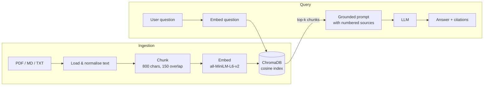

# RAG Document Chatbot


Chat with your own documents. Upload PDFs, Markdown or text files and ask questions in plain language. The app finds the most relevant passages with **semantic search** and has an **LLM answer only from those passages, with citations**. This is Retrieval-Augmented Generation (RAG).

It works with **any OpenAI-compatible LLM**: OpenAI, Groq, Together, or a fully local model through **Ollama**. With no API key it still runs in *retrieval-only* mode and returns the best-matching passage.

## How it works



## Features

- 📄 **Multi-format ingestion:** PDF (via `pypdf`), Markdown and plain text, uploaded from the UI, the API or a CLI.
- ✂️ **Smart chunking:** overlapping windows that prefer paragraph and sentence boundaries.
- 🔎 **Local vector search:** ChromaDB with on-disk persistence and CPU-only ONNX embeddings, so no GPU is needed.
- 🧠 **Grounded answers:** the system prompt forces answers from the retrieved context, cited as `[1]`, `[2]`. The model is told to say "I don't know" rather than guess.
- 🔌 **Pluggable LLM:** set `LLM_BASE_URL` to switch between OpenAI, Groq or local Ollama.
- 🖥️ **Built-in web UI:** a single-page chat interface served by FastAPI.
- 🐳 **Docker + CI:** a containerised app with a persistent volume, plus GitHub Actions for lint, tests and image build.
- ✅ **Offline tests:** tests use a deterministic hashing embedder, so CI needs no model download or API key.

## Project structure

```
rag-document-chatbot/
├── rag/
│   ├── chunking.py   # loaders (pdf/md/txt) + overlap chunker
│   ├── store.py      # ChromaDB wrapper (add, search, reset)
│   ├── pipeline.py   # retrieval → prompt → LLM, retrieval-only fallback
│   └── ingest.py     # CLI: python -m rag.ingest <folder>
├── app/
│   ├── main.py       # FastAPI: /ingest /ask /documents /health
│   └── static/index.html
├── data/sample/      # example document to try immediately
├── tests/test_rag.py
├── Dockerfile · docker-compose.yml · Makefile
└── .github/workflows/ci.yml
```

## Quick start

```bash
git clone https://github.com/Muhammad-HamzaShamsi/rag-document-chatbot.git
cd rag-document-chatbot
python -m venv .venv && source .venv/bin/activate
make install
cp .env.example .env          # add an API key, or point it at Ollama
make ingest                   # index data/sample
make serve                    # open http://localhost:8000
```

### Docker

```bash
cp .env.example .env
docker compose up --build -d   # http://localhost:8000
```

### Fully local with Ollama (no API cost)

```bash
ollama pull llama3.1
# .env
LLM_BASE_URL=http://localhost:11434/v1
LLM_API_KEY=ollama
LLM_MODEL=llama3.1
```

## API

| Method   | Endpoint     | Description                                   |
|----------|--------------|-----------------------------------------------|
| `POST`   | `/ingest`    | Upload one or more files (multipart `files`)  |
| `POST`   | `/ask`       | `{"question": "..."}` → answer + sources      |
| `GET`    | `/documents` | Indexed documents and chunk count             |
| `DELETE` | `/documents` | Clear the index                               |
| `GET`    | `/health`    | Status, chunk count, LLM enabled              |

```bash
curl -F "files=@handbook.pdf" localhost:8000/ingest
curl -s -X POST localhost:8000/ask -H 'Content-Type: application/json' \
     -d '{"question":"How is data drift detected?"}' | jq
```

## Configuration

| Variable        | Default                      | Description                     |
|-----------------|------------------------------|---------------------------------|
| `LLM_API_KEY`   | *(empty → retrieval-only)*   | API key for the LLM endpoint    |
| `LLM_BASE_URL`  | `https://api.openai.com/v1`  | Any OpenAI-compatible base URL  |
| `LLM_MODEL`     | `gpt-4o-mini`                | Chat model name                 |
| `CHROMA_DIR`    | `chroma_db`                  | Vector store location           |
| `CHUNK_SIZE`    | `800`                        | Characters per chunk            |
| `CHUNK_OVERLAP` | `150`                        | Overlap between chunks          |
| `TOP_K`         | `4`                          | Chunks retrieved per question   |

## Roadmap

- [ ] Hybrid search (BM25 + vectors) and re-ranking
- [ ] Streaming responses
- [ ] Evaluation set with RAGAS-style faithfulness metrics
- [ ] Conversation memory

## License

MIT © Muhammad Hamza Shamsi
